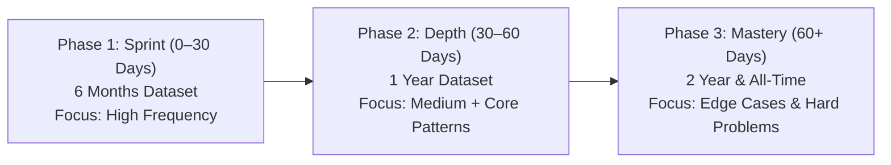

# LeetCode Questions Company-Wise 🚀

[](#complete-company-directory)
[](#dataset-structure--time-windows)
[](#dataset-structure--time-windows)
[](#csv-schema--column-reference)
[](#license--disclaimer)

A comprehensive, curated collection of company-specific **LeetCode** coding interview problems. This repository indexes technical questions asked across **200 top tech companies, quantitative trading firms, financial institutions, and hyper-growth startups**, tagged with real-world interview frequency scores and categorized across **four distinct temporal windows**.

---

## 📌 Table of Contents

- [Overview](#overview)
- [Key Features](#key-features)
- [Dataset Structure & Time Windows](#dataset-structure--time-windows)
- [CSV Schema & Column Reference](#csv-schema--column-reference)
- [Top Companies (Quick Links)](#top-companies-quick-links)
- [Strategic Interview Preparation Roadmap](#strategic-interview-preparation-roadmap)
- [Practical Usage & Code Recipes](#practical-usage--code-recipes)
  - [Python / Pandas Recipes](#python--pandas-recipes)
  - [Command-Line Recipes (Bash / PowerShell)](#command-line-recipes-bash--powershell)
- [Complete Company Directory](#complete-company-directory)
- [Frequently Asked Questions (FAQ)](#frequently-asked-questions-faq)
- [Contributing](#contributing)
- [License & Disclaimer](#license--disclaimer)

---

## 🔍 Overview

Cracking technical coding interviews requires focused, targeted preparation. Companies frequently reuse question archetypes, test specific domain skills, or rotate problems on predictable schedules. 

This repository provides **537 clean, machine-readable CSV files** mapping problems to individual hiring teams. Instead of randomly grinding hundreds of generic problems, candidates and educators can:
- Target specific target companies (e.g., Google, Citadel, Meta, Amazon, Apple, Microsoft).
- Filter problems by recency (focus on the last 6 months for upcoming interviews).
- Prioritize high-yield questions using algorithmic frequency weights.
- Filter by difficulty level (`Easy`, `Medium`, `Hard`) and acceptance ratios.

---

## ✨ Key Features

- **200 Leading Companies**: Covers Big Tech (FAANG/MAMAA), FinTech & Quant Trading (Citadel, Two Sigma, Jane Street, Akuna, Bloomberg), Cloud/SaaS, and Unicorns.
- **4 Granular Time Windows**: `6months`, `1year`, `2year`, and `alltime`.
- **Standardized Schema**: All CSVs strictly follow a 6-column tabular layout with uniform headers.
- **Frequency Scoring**: Preserves LeetCode interview appearance weights so you know which questions appear most often.
- **Direct Hyperlinks**: Every entry includes a direct link to the LeetCode problem.
- **Tooling-Ready**: 100% compatible with Pandas, Excel, Google Sheets, SQLite, Notion tables, and terminal CLI utilities.

---

## 📂 Dataset Structure & Time Windows

Each dataset file follows a predictable naming convention:

```
<company-slug>_<timeframe>.csv
```

### Timeframe Definitions

| Timeframe Window | Filename Suffix | Recommended Use Case |
|:---|:---|:---|
| **Last 6 Months** | `*_6months.csv` | **High Priority**: Immediate preparation for interviews scheduled within the next 1–4 weeks. Captures current question pool rotations. |
| **Past 1 Year** | `*_1year.csv` | **Medium-High Priority**: Core preparation (1–3 months out). Balances freshness with strong statistical representation. |
| **Past 2 Years** | `*_2year.csv` | **Comprehensive Review**: Thorough prep (3–6 months out). Reveals recurring algorithmic themes favored by interviewers. |
| **All-Time** | `*_alltime.csv` | **Foundational Study**: Complete historical archive. Ideal for mastering company classics and timeless technical benchmarks. |

---

## 📋 CSV Schema & Column Reference

All 537 CSV files adhere strictly to the following 6-column header:

```csv
ID,Title,Acceptance,Difficulty,Frequency,Leetcode Question Link
```

### Column Definitions

| Column | Data Type | Example | Description |
|:---|:---|:---|:---|
| `ID` | Integer | `200` | The official LeetCode problem identification number. |
| `Title` | String | `Number of Islands` | The canonical title of the problem on LeetCode. |
| `Acceptance` | Percentage String | `46.8%` | Community pass rate. Lower percentages (< 35%) indicate tricky edge cases or rigorous constraints. |
| `Difficulty` | Categorical | `Medium` | Problem tier: `Easy`, `Medium`, or `Hard`. |
| `Frequency` | Float | `3.659` | Relative frequency score representing candidate encounter rate. Higher values indicate higher probability of encounter. |
| `Leetcode Question Link` | URL | `https://leetcode.com/problems/number-of-islands` | Direct link to read and solve the problem on LeetCode. |

---

## 🏢 Top Companies (Quick Links)

Below are quick links to the most frequently queried company question banks:

### Big Tech & FAANG / MAMAA
| Company | 6 Months | 1 Year | 2 Years | All-Time |
|:---|:---:|:---:|:---:|:---:|
| **Amazon** | [6 Months](amazon_6months.csv) | [1 Year](amazon_1year.csv) | [2 Years](amazon_2year.csv) | [All-Time](amazon_alltime.csv) |
| **Apple** | [6 Months](apple_6months.csv) | [1 Year](apple_1year.csv) | [2 Years](apple_2year.csv) | [All-Time](apple_alltime.csv) |
| **Google** | [6 Months](google_6months.csv) | [1 Year](google_1year.csv) | [2 Years](google_2year.csv) | [All-Time](google_alltime.csv) |
| **Meta / Facebook** | [6 Months](facebook_6months.csv) | [1 Year](facebook_1year.csv) | [2 Years](facebook_2year.csv) | [All-Time](facebook_alltime.csv) |
| **Microsoft** | [6 Months](microsoft_6months.csv) | [1 Year](microsoft_1year.csv) | [2 Years](microsoft_2year.csv) | [All-Time](microsoft_alltime.csv) |
| **Netflix** | [6 Months](netflix_6months.csv) | [1 Year](netflix_1year.csv) | [2 Years](netflix_2year.csv) | [All-Time](netflix_alltime.csv) |

### FinTech & Quantitative Trading
| Firm | 6 Months | 1 Year | 2 Years | All-Time |
|:---|:---:|:---:|:---:|:---:|
| **Akuna Capital** | [6 Months](akuna-capital_6months.csv) | [1 Year](akuna-capital_1year.csv) | [2 Years](akuna-capital_2year.csv) | [All-Time](akuna-capital_alltime.csv) |
| **BlackRock** | — | [1 Year](blackrock_1year.csv) | [2 Years](blackrock_2year.csv) | [All-Time](blackrock_alltime.csv) |
| **Bloomberg** | [6 Months](bloomberg_6months.csv) | [1 Year](bloomberg_1year.csv) | [2 Years](bloomberg_2year.csv) | [All-Time](bloomberg_alltime.csv) |
| **Citadel** | [6 Months](citadel_6months.csv) | [1 Year](citadel_1year.csv) | [2 Years](citadel_2year.csv) | [All-Time](citadel_alltime.csv) |
| **DE Shaw** | — | — | — | [All-Time](de-shaw_alltime.csv) |
| **Goldman Sachs** | [6 Months](goldman-sachs_6months.csv) | [1 Year](goldman-sachs_1year.csv) | [2 Years](goldman-sachs_2year.csv) | [All-Time](goldman-sachs_alltime.csv) |
| **Hudson River Trading (HRT)** | — | — | — | [All-Time](hrt_alltime.csv) |
| **Jane Street** | — | — | — | [All-Time](jane-street_alltime.csv) |
| **JPMorgan Chase** | [6 Months](jpmorgan_6months.csv) | [1 Year](jpmorgan_1year.csv) | [2 Years](jpmorgan_2year.csv) | [All-Time](jpmorgan_alltime.csv) |
| **Jump Trading** | — | — | [2 Years](jump-trading_2year.csv) | [All-Time](jump-trading_alltime.csv) |
| **Morgan Stanley** | — | [1 Year](morgan-stanley_1year.csv) | [2 Years](morgan-stanley_2year.csv) | [All-Time](morgan-stanley_alltime.csv) |
| **Point72** | — | — | — | [All-Time](point72_alltime.csv) |
| **Two Sigma** | [6 Months](two-sigma_6months.csv) | [1 Year](two-sigma_1year.csv) | [2 Years](two-sigma_2year.csv) | [All-Time](two-sigma_alltime.csv) |

### High-Growth Tech & Unicorns
| Company | 6 Months | 1 Year | 2 Years | All-Time |
|:---|:---:|:---:|:---:|:---:|
| **Airbnb** | [6 Months](airbnb_6months.csv) | [1 Year](airbnb_1year.csv) | [2 Years](airbnb_2year.csv) | [All-Time](airbnb_alltime.csv) |
| **ByteDance** | [6 Months](bytedance_6months.csv) | [1 Year](bytedance_1year.csv) | [2 Years](bytedance_2year.csv) | [All-Time](bytedance_alltime.csv) |
| **Databricks** | [6 Months](databricks_6months.csv) | [1 Year](databricks_1year.csv) | [2 Years](databricks_2year.csv) | [All-Time](databricks_alltime.csv) |
| **DoorDash** | [6 Months](doordash_6months.csv) | [1 Year](doordash_1year.csv) | [2 Years](doordash_2year.csv) | [All-Time](doordash_alltime.csv) |
| **Dropbox** | [6 Months](dropbox_6months.csv) | [1 Year](dropbox_1year.csv) | [2 Years](dropbox_2year.csv) | [All-Time](dropbox_alltime.csv) |
| **LinkedIn** | [6 Months](linkedin_6months.csv) | [1 Year](linkedin_1year.csv) | [2 Years](linkedin_2year.csv) | [All-Time](linkedin_alltime.csv) |
| **Lyft** | [6 Months](lyft_6months.csv) | [1 Year](lyft_1year.csv) | [2 Years](lyft_2year.csv) | [All-Time](lyft_alltime.csv) |
| **Pinterest** | [6 Months](pinterest_6months.csv) | [1 Year](pinterest_1year.csv) | [2 Years](pinterest_2year.csv) | [All-Time](pinterest_alltime.csv) |
| **Robinhood** | [6 Months](robinhood_6months.csv) | [1 Year](robinhood_1year.csv) | [2 Years](robinhood_2year.csv) | [All-Time](robinhood_alltime.csv) |
| **Roblox** | [6 Months](roblox_6months.csv) | [1 Year](roblox_1year.csv) | [2 Years](roblox_2year.csv) | [All-Time](roblox_alltime.csv) |
| **Salesforce** | [6 Months](salesforce_6months.csv) | [1 Year](salesforce_1year.csv) | [2 Years](salesforce_2year.csv) | [All-Time](salesforce_alltime.csv) |
| **Snapchat** | [6 Months](snapchat_6months.csv) | [1 Year](snapchat_1year.csv) | [2 Years](snapchat_2year.csv) | [All-Time](snapchat_alltime.csv) |
| **Spotify** | [6 Months](spotify_6months.csv) | [1 Year](spotify_1year.csv) | [2 Years](spotify_2year.csv) | [All-Time](spotify_alltime.csv) |
| **Twitter** | [6 Months](twitter_6months.csv) | [1 Year](twitter_1year.csv) | [2 Years](twitter_2year.csv) | [All-Time](twitter_alltime.csv) |
| **Uber** | [6 Months](uber_6months.csv) | [1 Year](uber_1year.csv) | [2 Years](uber_2year.csv) | [All-Time](uber_alltime.csv) |

---

## 🎯 Strategic Interview Preparation Roadmap



### Phase 1: High-Frequency Sprint (0 – 30 Days before interview)
- **Target File**: `<target_company>_6months.csv`
- **Tactic**: Sort by `Frequency` descending. Solve the top 20–30 problems.
- **Why**: Questions asked in the last 6 months represent current interviewer question pools and ongoing company-wide initiatives.

### Phase 2: Core Pattern Solidification (30 – 60 Days)
- **Target File**: `<target_company>_1year.csv`
- **Tactic**: Filter for `Medium` difficulty with `Acceptance` between 35% and 60%.
- **Why**: Solidifies key data structures (Graph BFS/DFS, Heaps, Sliding Window, DP) favored by that particular engineering organization.

### Phase 3: Comprehensive Mastery (60+ Days)
- **Target Files**: `<target_company>_2year.csv` and `<target_company>_alltime.csv`
- **Tactic**: Tackle company-defining `Hard` problems (e.g., Google’s string transforms, Meta’s expression parsing, Amazon’s topological network cuts).

---

## 💻 Practical Usage & Code Recipes

### Python / Pandas Recipes

#### 1. Load and sort the top 10 most frequent questions for a company
```python
import pandas as pd

# Load 6 months data for Google
df = pd.read_csv('google_6months.csv')

# Clean frequency column to numeric
df['Frequency'] = pd.to_numeric(df['Frequency'], errors='coerce')

# Display top 10 most frequent questions
top10 = df.sort_values(by='Frequency', ascending=False).head(10)
print(top10[['ID', 'Title', 'Difficulty', 'Frequency']])
```

#### 2. Filter Medium and Hard questions with acceptance rate > 40%
```python
import pandas as pd

df = pd.read_csv('amazon_1year.csv')

# Clean acceptance rate percentage
df['Acceptance_Float'] = df['Acceptance'].str.rstrip('%').astype(float)

# Filter criteria
curated = df[
    (df['Difficulty'].isin(['Medium', 'Hard'])) &
    (df['Acceptance_Float'] >= 40.0)
].sort_values(by='Frequency', ascending=False)

print(f"Total matching questions: {len(curated)}")
print(curated[['ID', 'Title', 'Difficulty', 'Acceptance']].head())
```

#### 3. Find common questions asked by two different companies
```python
import pandas as pd

google = pd.read_csv('google_1year.csv')
meta = pd.read_csv('facebook_1year.csv')

# Inner join on problem ID
overlap = pd.merge(google, meta, on='ID', suffixes=('_google', '_meta'))

print(f"Overlap count: {len(overlap)}")
print(overlap[['ID', 'Title_google', 'Difficulty_google']].head(10))
```

---

### Command-Line Recipes (Bash / PowerShell)

#### Search for a problem across all companies (Bash / Ripgrep / Grep)
```bash
# Find every company that asked "Number of Islands" in the last 6 months
grep -i "Number of Islands" *_6months.csv

# Find all Hard questions in Apple datasets
grep ",Hard," apple_*.csv
```

#### Search for questions using PowerShell (Windows)
```powershell
# Search for graph problems in Google datasets
Select-String -Path "google_*.csv" -Pattern "Graph|Island|Course"

# Find top 5 rows of Bloomberg 6-month questions
Get-Content -Path "bloomberg_6months.csv" -TotalCount 6
```

---

## 📚 Complete Company Directory

All 200 companies included in this repository are cataloged alphabetically below. Click any link to open the respective CSV directly:

<details open>
<summary><b>Click to expand / collapse full company list (A–Z)</b></summary>

<br>

### A
| Company | Available Datasets |
|:---|:---|
| **Accolite** | [All-Time](accolite_alltime.csv) |
| **Adobe** | [6 Months](adobe_6months.csv) • [1 Year](adobe_1year.csv) • [2 Years](adobe_2year.csv) • [All-Time](adobe_alltime.csv) |
| **Aetion** | [2 Years](aetion_2year.csv) • [All-Time](aetion_alltime.csv) |
| **Affinity** | [All-Time](affinity_alltime.csv) |
| **Affirm** | [6 Months](affirm_6months.csv) • [1 Year](affirm_1year.csv) • [2 Years](affirm_2year.csv) • [All-Time](affirm_alltime.csv) |
| **Airbnb** | [6 Months](airbnb_6months.csv) • [1 Year](airbnb_1year.csv) • [2 Years](airbnb_2year.csv) • [All-Time](airbnb_alltime.csv) |
| **Airtel** | [All-Time](airtel_alltime.csv) |
| **Akamai** | [All-Time](akamai_alltime.csv) |
| **Akuna Capital** | [6 Months](akuna-capital_6months.csv) • [1 Year](akuna-capital_1year.csv) • [2 Years](akuna-capital_2year.csv) • [All-Time](akuna-capital_alltime.csv) / [Akuna (legacy)](akuna_alltime.csv) |
| **Alation** | [1 Year](alation_1year.csv) • [2 Years](alation_2year.csv) • [All-Time](alation_alltime.csv) |
| **Alibaba** | [6 Months](alibaba_6months.csv) • [1 Year](alibaba_1year.csv) • [2 Years](alibaba_2year.csv) • [All-Time](alibaba_alltime.csv) |
| **Amazon** | [6 Months](amazon_6months.csv) • [1 Year](amazon_1year.csv) • [2 Years](amazon_2year.csv) • [All-Time](amazon_alltime.csv) |
| **American Express** | [All-Time](american-express_alltime.csv) |
| **AppDynamics** | [6 Months](appdynamics_6months.csv) • [1 Year](appdynamics_1year.csv) • [2 Years](appdynamics_2year.csv) • [All-Time](appdynamics_alltime.csv) |
| **Apple** | [6 Months](apple_6months.csv) • [1 Year](apple_1year.csv) • [2 Years](apple_2year.csv) • [All-Time](apple_alltime.csv) |
| **Arista Networks** | [1 Year](arista-networks_1year.csv) • [2 Years](arista-networks_2year.csv) • [All-Time](arista-networks_alltime.csv) / [Arista](arista_alltime.csv) |
| **Asana** | [6 Months](asana_6months.csv) • [1 Year](asana_1year.csv) • [2 Years](asana_2year.csv) • [All-Time](asana_alltime.csv) |
| **Atlassian** | [6 Months](atlassian_6months.csv) • [1 Year](atlassian_1year.csv) • [2 Years](atlassian_2year.csv) • [All-Time](atlassian_alltime.csv) |
| **Audible** | [6 Months](audible_6months.csv) • [1 Year](audible_1year.csv) • [2 Years](audible_2year.csv) • [All-Time](audible_alltime.csv) |

### B
| Company | Available Datasets |
|:---|:---|
| **Baidu** | [2 Years](baidu_2year.csv) • [All-Time](baidu_alltime.csv) |
| **Barclays** | [1 Year](barclays_1year.csv) • [2 Years](barclays_2year.csv) • [All-Time](barclays_alltime.csv) |
| **BlackRock** | [1 Year](blackrock_1year.csv) • [2 Years](blackrock_2year.csv) • [All-Time](blackrock_alltime.csv) |
| **Blizzard Entertainment** | [2 Years](blizzard_2year.csv) • [All-Time](blizzard_alltime.csv) |
| **Bloomberg** | [6 Months](bloomberg_6months.csv) • [1 Year](bloomberg_1year.csv) • [2 Years](bloomberg_2year.csv) • [All-Time](bloomberg_alltime.csv) |
| **Bloomreach** | [All-Time](bloomreach_alltime.csv) |
| **Booking.com** | [2 Years](bookingcom_2year.csv) • [All-Time](bookingcom_alltime.csv) / [Booking](booking_alltime.csv) |
| **Box** | [6 Months](box_6months.csv) • [1 Year](box_1year.csv) • [2 Years](box_2year.csv) • [All-Time](box_alltime.csv) |
| **ByteDance** | [6 Months](bytedance_6months.csv) • [1 Year](bytedance_1year.csv) • [2 Years](bytedance_2year.csv) • [All-Time](bytedance_alltime.csv) / [Toutiao](bytedancetoutiao_alltime.csv) |

### C
| Company | Available Datasets |
|:---|:---|
| **C3 AI** | [All-Time (C3.ai)](c3ai_alltime.csv) • [All-Time (C3 IoT)](c3-iot_alltime.csv) |
| **Capital One** | [6 Months](capital-one_6months.csv) • [1 Year](capital-one_1year.csv) • [2 Years](capital-one_2year.csv) • [All-Time](capital-one_alltime.csv) |
| **Cisco** | [6 Months](cisco_6months.csv) • [1 Year](cisco_1year.csv) • [2 Years](cisco_2year.csv) • [All-Time](cisco_alltime.csv) |
| **Citadel** | [6 Months](citadel_6months.csv) • [1 Year](citadel_1year.csv) • [2 Years](citadel_2year.csv) • [All-Time](citadel_alltime.csv) |
| **Citrix** | [6 Months](citrix_6months.csv) • [1 Year](citrix_1year.csv) • [2 Years](citrix_2year.csv) • [All-Time](citrix_alltime.csv) |
| **Cloudera** | [6 Months](cloudera_6months.csv) • [1 Year](cloudera_1year.csv) • [2 Years](cloudera_2year.csv) • [All-Time](cloudera_alltime.csv) |
| **Clutter** | [All-Time](clutter_alltime.csv) |
| **CodeNation** | [All-Time](codenation_alltime.csv) |
| **Cohesity** | [1 Year](cohesity_1year.csv) • [2 Years](cohesity_2year.csv) • [All-Time](cohesity_alltime.csv) |
| **Coupang** | [6 Months](coupang_6months.csv) • [1 Year](coupang_1year.csv) • [2 Years](coupang_2year.csv) • [All-Time](coupang_alltime.csv) |
| **Coursera** | [6 Months](coursera_6months.csv) • [1 Year](coursera_1year.csv) • [2 Years](coursera_2year.csv) • [All-Time](coursera_alltime.csv) |
| **Cruise Automation** | [6 Months](cruise-automation_6months.csv) • [1 Year](cruise-automation_1year.csv) • [2 Years](cruise-automation_2year.csv) • [All-Time](cruise-automation_alltime.csv) |

### D
| Company | Available Datasets |
|:---|:---|
| **Databricks** | [6 Months](databricks_6months.csv) • [1 Year](databricks_1year.csv) • [2 Years](databricks_2year.csv) • [All-Time](databricks_alltime.csv) |
| **Dataminr** | [1 Year](dataminr_1year.csv) • [2 Years](dataminr_2year.csv) • [All-Time](dataminr_alltime.csv) |
| **DE Shaw** | [All-Time](de-shaw_alltime.csv) |
| **Delivery Hero** | [All-Time](deliveryhero_alltime.csv) |
| **Dell** | [1 Year](dell_1year.csv) • [2 Years](dell_2year.csv) • [All-Time](dell_alltime.csv) |
| **Deutsche Bank** | [2 Years](deutsche-bank_2year.csv) • [All-Time](deutsche-bank_alltime.csv) |
| **DiDi** | [6 Months](didi_6months.csv) • [1 Year](didi_1year.csv) • [2 Years](didi_2year.csv) • [All-Time](didi_alltime.csv) |
| **DocuSign** | [6 Months](docusign_6months.csv) • [1 Year](docusign_1year.csv) • [2 Years](docusign_2year.csv) • [All-Time](docusign_alltime.csv) |
| **DoorDash** | [6 Months](doordash_6months.csv) • [1 Year](doordash_1year.csv) • [2 Years](doordash_2year.csv) • [All-Time](doordash_alltime.csv) |
| **Drawbridge** | [2 Years](drawbridge_2year.csv) • [All-Time](drawbridge_alltime.csv) |
| **Dropbox** | [6 Months](dropbox_6months.csv) • [1 Year](dropbox_1year.csv) • [2 Years](dropbox_2year.csv) • [All-Time](dropbox_alltime.csv) |
| **Druva** | [All-Time](druva_alltime.csv) |

### E
| Company | Available Datasets |
|:---|:---|
| **eBay** | [6 Months](ebay_6months.csv) • [1 Year](ebay_1year.csv) • [2 Years](ebay_2year.csv) • [All-Time](ebay_alltime.csv) |
| **Electronic Arts (EA)** | [1 Year](electronic-arts_1year.csv) • [2 Years](electronic-arts_2year.csv) • [All-Time](electronic-arts_alltime.csv) |
| **EMC** | [2 Years](emc_2year.csv) • [All-Time](emc_alltime.csv) |
| **Epic Systems** | [1 Year](epic-systems_1year.csv) • [2 Years](epic-systems_2year.csv) • [All-Time](epic-systems_alltime.csv) |
| **Evernote** | [1 Year](evernote_1year.csv) • [2 Years](evernote_2year.csv) • [All-Time](evernote_alltime.csv) |
| **Expedia** | [1 Year](expedia_1year.csv) • [2 Years](expedia_2year.csv) • [All-Time](expedia_alltime.csv) |

### F
| Company | Available Datasets |
|:---|:---|
| **F5 Networks** | [All-Time](f5-networks_alltime.csv) |
| **Facebook / Meta** | [6 Months](facebook_6months.csv) • [1 Year](facebook_1year.csv) • [2 Years](facebook_2year.csv) • [All-Time](facebook_alltime.csv) |
| **FactSet** | [6 Months](factset_6months.csv) • [1 Year](factset_1year.csv) • [2 Years](factset_2year.csv) • [All-Time](factset_alltime.csv) |
| **Fallible** | [All-Time](fallible_alltime.csv) |
| **Fidessa** | [All-Time](fidessa_alltime.csv) |
| **Flexport** | [All-Time](flexport_alltime.csv) |
| **Flipkart** | [1 Year](flipkart_1year.csv) • [2 Years](flipkart_2year.csv) • [All-Time](flipkart_alltime.csv) |
| **ForUsAll** | [2 Years](forusall_2year.csv) • [All-Time](forusall_alltime.csv) |

### G
| Company | Available Datasets |
|:---|:---|
| **Garena** | [2 Years](garena_2year.csv) • [All-Time](garena_alltime.csv) |
| **GE Digital** | [2 Years](ge-digital_2year.csv) • [All-Time](ge-digital_alltime.csv) |
| **Gilt Groupe** | [All-Time](gilt-groupe_alltime.csv) |
| **GoDaddy** | [6 Months](godaddy_6months.csv) • [1 Year](godaddy_1year.csv) • [2 Years](godaddy_2year.csv) • [All-Time](godaddy_alltime.csv) |
| **Goldman Sachs** | [6 Months](goldman-sachs_6months.csv) • [1 Year](goldman-sachs_1year.csv) • [2 Years](goldman-sachs_2year.csv) • [All-Time](goldman-sachs_alltime.csv) |
| **Google** | [6 Months](google_6months.csv) • [1 Year](google_1year.csv) • [2 Years](google_2year.csv) • [All-Time](google_alltime.csv) |
| **Grab** | [1 Year](grab_1year.csv) • [2 Years](grab_2year.csv) • [All-Time](grab_alltime.csv) |
| **Groupon** | [6 Months](groupon_6months.csv) • [1 Year](groupon_1year.csv) • [2 Years](groupon_2year.csv) • [All-Time](groupon_alltime.csv) |
| **GSN Games** | [All-Time](gsn-games_alltime.csv) |

### H
| Company | Available Datasets |
|:---|:---|
| **HBO** | [2 Years](hbo_2year.csv) • [All-Time](hbo_alltime.csv) |
| **Helix** | [All-Time](helix_alltime.csv) |
| **Honey** | [All-Time](honey_alltime.csv) |
| **Hotstar** | [All-Time](hotstar_alltime.csv) |
| **Houzz** | [1 Year](houzz_1year.csv) • [2 Years](houzz_2year.csv) • [All-Time](houzz_alltime.csv) |
| **Hudson River Trading (HRT)** | [All-Time](hrt_alltime.csv) |
| **Huawei** | [6 Months](huawei_6months.csv) • [1 Year](huawei_1year.csv) • [2 Years](huawei_2year.csv) • [All-Time](huawei_alltime.csv) |
| **Hulu** | [6 Months](hulu_6months.csv) • [1 Year](hulu_1year.csv) • [2 Years](hulu_2year.csv) • [All-Time](hulu_alltime.csv) |

### I
| Company | Available Datasets |
|:---|:---|
| **IBM** | [6 Months](ibm_6months.csv) • [1 Year](ibm_1year.csv) • [2 Years](ibm_2year.csv) • [All-Time](ibm_alltime.csv) |
| **IIT Bombay** | [All-Time](iit-bombay_alltime.csv) |
| **Indeed** | [6 Months](indeed_6months.csv) • [1 Year](indeed_1year.csv) • [2 Years](indeed_2year.csv) • [All-Time](indeed_alltime.csv) |
| **Infosys** | [All-Time](infosys_alltime.csv) |
| **InMobi** | [All-Time](inmobi_alltime.csv) |
| **Intel** | [1 Year](intel_1year.csv) • [2 Years](intel_2year.csv) • [All-Time](intel_alltime.csv) |
| **Intuit** | [6 Months](intuit_6months.csv) • [1 Year](intuit_1year.csv) • [2 Years](intuit_2year.csv) • [All-Time](intuit_alltime.csv) |
| **IXL Learning** | [6 Months](ixl_6months.csv) • [1 Year](ixl_1year.csv) • [2 Years](ixl_2year.csv) • [All-Time](ixl_alltime.csv) |

### J
| Company | Available Datasets |
|:---|:---|
| **Jane Street** | [All-Time](jane-street_alltime.csv) |
| **Jingchi** | [All-Time](jingchi_alltime.csv) |
| **JPMorgan Chase** | [6 Months](jpmorgan_6months.csv) • [1 Year](jpmorgan_1year.csv) • [2 Years](jpmorgan_2year.csv) • [All-Time](jpmorgan_alltime.csv) / [JP Morgan (legacy)](jp-morgan-chase_alltime.csv) |
| **Jump Trading** | [2 Years](jump-trading_2year.csv) • [All-Time](jump-trading_alltime.csv) |

### K
| Company | Available Datasets |
|:---|:---|
| **Kakao** | [All-Time](kakao_alltime.csv) |
| **Karat** | [6 Months](karat_6months.csv) • [1 Year](karat_1year.csv) • [2 Years](karat_2year.csv) • [All-Time](karat_alltime.csv) |

### L
| Company | Available Datasets |
|:---|:---|
| **Leap Motion** | [All-Time](leap-motion_alltime.csv) |
| **LimeBike** | [All-Time](limebike_alltime.csv) |
| **LinkedIn** | [6 Months](linkedin_6months.csv) • [1 Year](linkedin_1year.csv) • [2 Years](linkedin_2year.csv) • [All-Time](linkedin_alltime.csv) |
| **LiveRamp** | [1 Year](liveramp_1year.csv) • [2 Years](liveramp_2year.csv) • [All-Time](liveramp_alltime.csv) |
| **Lyft** | [6 Months](lyft_6months.csv) • [1 Year](lyft_1year.csv) • [2 Years](lyft_2year.csv) • [All-Time](lyft_alltime.csv) |

### M
| Company | Available Datasets |
|:---|:---|
| **Machine Zone** | [All-Time (Machine Zone)](machine-zone_alltime.csv) • [All-Time (Machinezone)](machinezone_alltime.csv) |
| **MAQ Software** | [All-Time](maq-software_alltime.csv) |
| **MathWorks** | [6 Months](mathworks_6months.csv) • [1 Year](mathworks_1year.csv) • [2 Years](mathworks_2year.csv) • [All-Time](mathworks_alltime.csv) |
| **McKinsey & Company** | [All-Time](mckinsey_alltime.csv) |
| **Media.net** | [All-Time](medianet_alltime.csv) |
| **Meituan** | [2 Years](meituan_2year.csv) • [All-Time](meituan_alltime.csv) |
| **Microsoft** | [6 Months](microsoft_6months.csv) • [1 Year](microsoft_1year.csv) • [2 Years](microsoft_2year.csv) • [All-Time](microsoft_alltime.csv) |
| **MicroStrategy** | [All-Time](microstrategy_alltime.csv) |
| **Morgan Stanley** | [1 Year](morgan-stanley_1year.csv) • [2 Years](morgan-stanley_2year.csv) • [All-Time](morgan-stanley_alltime.csv) |

### N
| Company | Available Datasets |
|:---|:---|
| **National Instruments** | [All-Time](national-instruments_alltime.csv) |
| **NetEase** | [2 Years](netease_2year.csv) • [All-Time](netease_alltime.csv) |
| **Netflix** | [6 Months](netflix_6months.csv) • [1 Year](netflix_1year.csv) • [2 Years](netflix_2year.csv) • [All-Time](netflix_alltime.csv) |
| **NetSuite** | [All-Time](netsuite_alltime.csv) |
| **Nutanix** | [6 Months](nutanix_6months.csv) • [1 Year](nutanix_1year.csv) • [2 Years](nutanix_2year.csv) • [All-Time](nutanix_alltime.csv) |
| **Nvidia** | [6 Months](nvidia_6months.csv) • [1 Year](nvidia_1year.csv) • [2 Years](nvidia_2year.csv) • [All-Time](nvidia_alltime.csv) |

### O
| Company | Available Datasets |
|:---|:---|
| **Opendoor** | [1 Year](opendoor_1year.csv) • [2 Years](opendoor_2year.csv) • [All-Time](opendoor_alltime.csv) |
| **Oracle** | [6 Months](oracle_6months.csv) • [1 Year](oracle_1year.csv) • [2 Years](oracle_2year.csv) • [All-Time](oracle_alltime.csv) |

### P
| Company | Available Datasets |
|:---|:---|
| **Palantir Technologies** | [6 Months](palantir-technologies_6months.csv) • [1 Year](palantir-technologies_1year.csv) • [2 Years](palantir-technologies_2year.csv) • [All-Time](palantir-technologies_alltime.csv) / [Palantir](palantir_alltime.csv) |
| **PayPal** | [6 Months](paypal_6months.csv) • [1 Year](paypal_1year.csv) • [2 Years](paypal_2year.csv) • [All-Time](paypal_alltime.csv) |
| **Paytm** | [All-Time](paytm_alltime.csv) |
| **PhonePe** | [All-Time](phonepe_alltime.csv) |
| **Pinterest** | [6 Months](pinterest_6months.csv) • [1 Year](pinterest_1year.csv) • [2 Years](pinterest_2year.csv) • [All-Time](pinterest_alltime.csv) |
| **Pocket Gems** | [6 Months](pocket-gems_6months.csv) • [1 Year](pocket-gems_1year.csv) • [2 Years](pocket-gems_2year.csv) • [All-Time](pocket-gems_alltime.csv) |
| **Point72** | [All-Time](point72_alltime.csv) |
| **Pony.ai** | [2 Years](ponyai_2year.csv) • [All-Time](ponyai_alltime.csv) |
| **Poshmark** | [All-Time](poshmark_alltime.csv) |
| **Postmates** | [6 Months](postmates_6months.csv) • [1 Year](postmates_1year.csv) • [2 Years](postmates_2year.csv) • [All-Time](postmates_alltime.csv) |
| **Poynt** | [All-Time](poynt_alltime.csv) |
| **Pramp** | [All-Time](pramp_alltime.csv) |
| **Pure Storage** | [6 Months](pure-storage_6months.csv) • [1 Year](pure-storage_1year.csv) • [2 Years](pure-storage_2year.csv) • [All-Time](pure-storage_alltime.csv) |

### Q
| Company | Available Datasets |
|:---|:---|
| **Qualcomm** | [6 Months](qualcomm_6months.csv) • [1 Year](qualcomm_1year.csv) • [2 Years](qualcomm_2year.csv) • [All-Time](qualcomm_alltime.csv) |
| **Qualtrics** | [6 Months](qualtrics_6months.csv) • [1 Year](qualtrics_1year.csv) • [2 Years](qualtrics_2year.csv) • [All-Time](qualtrics_alltime.csv) |
| **Quantcast** | [2 Years](quantcast_2year.csv) • [All-Time](quantcast_alltime.csv) |
| **Quip** | [6 Months](quip_6months.csv) • [1 Year](quip_1year.csv) • [2 Years](quip_2year.csv) • [All-Time](quip_alltime.csv) |
| **Quora** | [1 Year](quora_1year.csv) • [2 Years](quora_2year.csv) • [All-Time](quora_alltime.csv) |

### R
| Company | Available Datasets |
|:---|:---|
| **Rackspace** | [All-Time](rackspace_alltime.csv) |
| **Radius** | [2 Years](radius_2year.csv) • [All-Time](radius_alltime.csv) |
| **Reddit** | [6 Months](reddit_6months.csv) • [1 Year](reddit_1year.csv) • [2 Years](reddit_2year.csv) • [All-Time](reddit_alltime.csv) |
| **Redfin** | [1 Year](redfin_1year.csv) • [2 Years](redfin_2year.csv) • [All-Time](redfin_alltime.csv) |
| **Riot Games** | [6 Months](riot-games_6months.csv) • [1 Year](riot-games_1year.csv) • [2 Years](riot-games_2year.csv) • [All-Time](riot-games_alltime.csv) |
| **Robinhood** | [6 Months](robinhood_6months.csv) • [1 Year](robinhood_1year.csv) • [2 Years](robinhood_2year.csv) • [All-Time](robinhood_alltime.csv) |
| **Roblox** | [6 Months](roblox_6months.csv) • [1 Year](roblox_1year.csv) • [2 Years](roblox_2year.csv) • [All-Time](roblox_alltime.csv) |
| **Rubrik** | [2 Years](rubrik_2year.csv) • [All-Time](rubrik_alltime.csv) |

### S
| Company | Available Datasets |
|:---|:---|
| **Salesforce** | [6 Months](salesforce_6months.csv) • [1 Year](salesforce_1year.csv) • [2 Years](salesforce_2year.csv) • [All-Time](salesforce_alltime.csv) |
| **Samsung** | [6 Months](samsung_6months.csv) • [1 Year](samsung_1year.csv) • [2 Years](samsung_2year.csv) • [All-Time](samsung_alltime.csv) |
| **SAP** | [6 Months](sap_6months.csv) • [1 Year](sap_1year.csv) • [2 Years](sap_2year.csv) • [All-Time](sap_alltime.csv) |
| **Sapient** | [All-Time](sapient_alltime.csv) |
| **ServiceNow** | [6 Months](servicenow_6months.csv) • [1 Year](servicenow_1year.csv) • [2 Years](servicenow_2year.csv) • [All-Time](servicenow_alltime.csv) |
| **Snapchat** | [6 Months](snapchat_6months.csv) • [1 Year](snapchat_1year.csv) • [2 Years](snapchat_2year.csv) • [All-Time](snapchat_alltime.csv) |
| **Snapdeal** | [All-Time](snapdeal_alltime.csv) |
| **Splunk** | [6 Months](splunk_6months.csv) • [1 Year](splunk_1year.csv) • [2 Years](splunk_2year.csv) • [All-Time](splunk_alltime.csv) |
| **Spotify** | [6 Months](spotify_6months.csv) • [1 Year](spotify_1year.csv) • [2 Years](spotify_2year.csv) • [All-Time](spotify_alltime.csv) |
| **Square (Block)** | [6 Months](square_6months.csv) • [1 Year](square_1year.csv) • [2 Years](square_2year.csv) • [All-Time](square_alltime.csv) |
| **Sumo Logic** | [1 Year](sumologic_1year.csv) • [2 Years](sumologic_2year.csv) • [All-Time](sumologic_alltime.csv) |
| **Symantec** | [2 Years](symantec_2year.csv) • [All-Time](symantec_alltime.csv) |

### T
| Company | Available Datasets |
|:---|:---|
| **Tableau** | [6 Months](tableau_6months.csv) • [1 Year](tableau_1year.csv) • [2 Years](tableau_2year.csv) • [All-Time](tableau_alltime.csv) |
| **TandemG** | [All-Time](tandemg_alltime.csv) |
| **Tencent** | [6 Months](tencent_6months.csv) • [1 Year](tencent_1year.csv) • [2 Years](tencent_2year.csv) • [All-Time](tencent_alltime.csv) |
| **Tesla** | [6 Months](tesla_6months.csv) • [1 Year](tesla_1year.csv) • [2 Years](tesla_2year.csv) • [All-Time](tesla_alltime.csv) |
| **Thumbtack** | [All-Time](thumbtack_alltime.csv) |
| **Traveloka** | [All-Time](traveloka_alltime.csv) |
| **TripAdvisor** | [1 Year](tripadvisor_1year.csv) • [2 Years](tripadvisor_2year.csv) • [All-Time](tripadvisor_alltime.csv) |
| **Triplebyte** | [6 Months](triplebyte_6months.csv) • [1 Year](triplebyte_1year.csv) • [2 Years](triplebyte_2year.csv) • [All-Time](triplebyte_alltime.csv) |
| **Turvo** | [All-Time](turvo_alltime.csv) |
| **Twilio** | [6 Months](twilio_6months.csv) • [1 Year](twilio_1year.csv) • [2 Years](twilio_2year.csv) • [All-Time](twilio_alltime.csv) |
| **Twitch** | [6 Months](twitch_6months.csv) • [1 Year](twitch_1year.csv) • [2 Years](twitch_2year.csv) • [All-Time](twitch_alltime.csv) |
| **Twitter (X)** | [6 Months](twitter_6months.csv) • [1 Year](twitter_1year.csv) • [2 Years](twitter_2year.csv) • [All-Time](twitter_alltime.csv) |
| **Two Sigma** | [6 Months](two-sigma_6months.csv) • [1 Year](two-sigma_1year.csv) • [2 Years](two-sigma_2year.csv) • [All-Time](two-sigma_alltime.csv) |

### U
| Company | Available Datasets |
|:---|:---|
| **Uber** | [6 Months](uber_6months.csv) • [1 Year](uber_1year.csv) • [2 Years](uber_2year.csv) • [All-Time](uber_alltime.csv) |
| **UiPath** | [All-Time](uipath_alltime.csv) |
| **UnitedHealth Group** | [All-Time](united-health-group_alltime.csv) |

### V
| Company | Available Datasets |
|:---|:---|
| **Valve** | [2 Years](valve_2year.csv) • [All-Time](valve_alltime.csv) |
| **Virtu Financial** | [6 Months](virtu_6months.csv) • [1 Year](virtu_1year.csv) • [2 Years](virtu_2year.csv) • [All-Time](virtu_alltime.csv) |
| **Visa** | [6 Months](visa_6months.csv) • [1 Year](visa_1year.csv) • [2 Years](visa_2year.csv) • [All-Time](visa_alltime.csv) |
| **VMware** | [6 Months](vmware_6months.csv) • [1 Year](vmware_1year.csv) • [2 Years](vmware_2year.csv) • [All-Time](vmware_alltime.csv) |

### W
| Company | Available Datasets |
|:---|:---|
| **Walmart** | [All-Time](walmart_alltime.csv) |
| **Wayfair** | [6 Months](wayfair_6months.csv) • [1 Year](wayfair_1year.csv) • [2 Years](wayfair_2year.csv) • [All-Time](wayfair_alltime.csv) |
| **Wish** | [6 Months](wish_6months.csv) • [1 Year](wish_1year.csv) • [2 Years](wish_2year.csv) • [All-Time](wish_alltime.csv) |
| **Works Applications** | [2 Years](works-applications_2year.csv) • [All-Time](works-applications_alltime.csv) |

### Y
| Company | Available Datasets |
|:---|:---|
| **Yahoo** | [6 Months](yahoo_6months.csv) • [1 Year](yahoo_1year.csv) • [2 Years](yahoo_2year.csv) • [All-Time](yahoo_alltime.csv) |
| **Yandex** | [6 Months](yandex_6months.csv) • [1 Year](yandex_1year.csv) • [2 Years](yandex_2year.csv) • [All-Time](yandex_alltime.csv) |
| **Yatra** | [All-Time](yatra_alltime.csv) |
| **Yelp** | [1 Year](yelp_1year.csv) • [2 Years](yelp_2year.csv) • [All-Time](yelp_alltime.csv) |

### Z
| Company | Available Datasets |
|:---|:---|
| **Zalando** | [All-Time](zalando_alltime.csv) |
| **Zappos** | [1 Year](zappos_1year.csv) • [2 Years](zappos_2year.csv) • [All-Time](zappos_alltime.csv) |
| **Zenefits** | [All-Time](zenefits_alltime.csv) |
| **Zillow** | [6 Months](zillow_6months.csv) • [1 Year](zillow_1year.csv) • [2 Years](zillow_2year.csv) • [All-Time](zillow_alltime.csv) |
| **Zoho** | [1 Year](zoho_1year.csv) • [2 Years](zoho_2year.csv) • [All-Time](zoho_alltime.csv) |
| **Zscaler** | [All-Time](zscaler_alltime.csv) |
| **Zulily** | [1 Year](zulily_1year.csv) • [2 Years](zulily_2year.csv) • [All-Time](zulily_alltime.csv) |

</details>

---

## ❓ Frequently Asked Questions (FAQ)

<details>
<summary><b>1. How are the frequency scores calculated?</b></summary>
The frequency score reflects the relative volume of candidate submissions and interview reports tagged with that question for a given company on LeetCode Premium. A higher score signifies that the question was reported more frequently in technical rounds during that timeframe window.
</details>

<details>
<summary><b>2. Why do some companies only have <code>alltime</code> files?</b></summary>
Certain organizations have lower total interview report volumes on LeetCode. To maintain statistical relevance and prevent noisy, single-question datasets, only time windows with sufficient data points are tracked.
</details>

<details>
<summary><b>3. Are premium questions included?</b></summary>
Yes. All questions historically tagged for that company (including LeetCode Premium questions) are listed. If a problem is locked on LeetCode, its ID and Title remain available so you can research identical or equivalent problems (e.g., on LintCode, GeeksforGeeks, or GitHub solutions).
</details>

<details>
<summary><b>4. How should I practice if I have an interview in less than a week?</b></summary>
Open your company's <code>*_6months.csv</code> file, sort descending by <code>Frequency</code>, and solve the top 15–20 problems. Ensure you can code clean solutions within 25–30 minutes without an IDE debugger.
</details>

---

## 🤝 Contributing

Contributions to update, correct, or expand question lists are welcome!

### Guidelines for Submissions
1. **Header Consistency**: Ensure new or modified CSV files retain the exact 6-column header:
   ```csv
   ID,Title,Acceptance,Difficulty,Frequency,Leetcode Question Link
   ```
2. **Naming Convention**: File names must follow `company-name_timeframe.csv` using lowercase letters and hyphens (e.g., `datadog_6months.csv`).
3. **Valid Links**: Ensure the `Leetcode Question Link` begins with `https://leetcode.com/problems/`.
4. **Encoding**: Save all files using standard UTF-8 text encoding.

### Submitting a Pull Request
1. Fork this repository.
2. Create a feature branch: `git checkout -b feature/update-company-questions`
3. Commit your changes: `git commit -m "Update Uber and Google 6-month questions"`
4. Push to branch: `git push origin feature/update-company-questions`
5. Open a Pull Request on GitHub.

---

## ⚖️ License & Disclaimer

- **License**: Distributed under the [MIT License](https://opensource.org/licenses/MIT).
- **Disclaimer**: *LeetCode* is a registered trademark of LeetCode LLC. This repository is an independent open-source educational curation and is not affiliated with, endorsed by, or sponsored by LeetCode LLC or any of the mentioned corporations.
