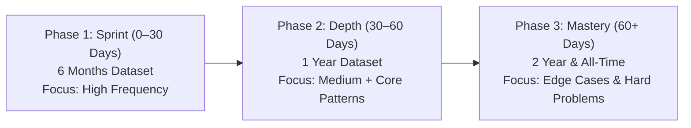

# LeetCode Questions Company-Wise 🚀

[](#complete-company-directory)
[](#dataset-structure--time-windows)
[](#dataset-structure--time-windows)
[](#csv-schema--column-reference)
[](#license--disclaimer)

A comprehensive, curated collection of company-specific **LeetCode** coding interview problems. This repository indexes technical questions asked across **200 top tech companies, quantitative trading firms, financial institutions, and hyper-growth startups**, tagged with real-world interview frequency scores and organized into **clean, company-specific folders** across **four distinct temporal windows**.

---

## 📌 Table of Contents

- [Overview](#overview)
- [Interactive Web Dashboard & Deployment](#interactive-web-dashboard--deployment)
- [Key Features](#key-features)
- [Dataset Structure & Time Windows](#dataset-structure--time-windows)
- [CSV Schema & Column Reference](#csv-schema--column-reference)
- [Top Companies (Quick Links)](#top-companies-quick-links)
- [Strategic Interview Preparation Roadmap](#strategic-interview-preparation-roadmap)
- [Practical Usage & Code Recipes](#practical-usage--code-recipes)
  - [Interactive CLI Query Tool (`query.py`)](#interactive-cli-query-tool-querypy)
  - [Python / Pandas Recipes](#python--pandas-recipes)
  - [Command-Line Recipes (Bash / PowerShell)](#command-line-recipes-bash--powershell)
- [Complete Company Directory](#complete-company-directory)
- [Frequently Asked Questions (FAQ)](#frequently-asked-questions-faq)
- [Contributing](#contributing)
- [License & Disclaimer](#license--disclaimer)

---

## 🔍 Overview

Cracking technical coding interviews requires focused, targeted preparation. Companies frequently reuse question archetypes, test specific domain skills, or rotate problems on predictable schedules. 

This repository organizes **537 clean, machine-readable CSV files** into **200 individual company folders** directly in the root. Instead of wading through a flat folder of hundreds of files, candidates and educators can navigate directly to the company of interest (e.g., `google/`, `citadel/`, `amazon/`):
- Target specific companies and engineering teams.
- Filter problems by recency (focus on the last 6 months for upcoming interviews).
- Prioritize high-yield questions using algorithmic frequency weights.
- Filter by difficulty level (`Easy`, `Medium`, `Hard`) and acceptance ratios.

---

## 🌐 Interactive Web Dashboard & Deployment

This repository includes a modern, zero-dependency interactive web dashboard in [`index.html`](index.html).

### ✨ Dashboard Capabilities
- **Explicit Rank Badges (`#1, #2, #3...`)**: Every problem displays its exact interview encounter rank with gold/silver/bronze highlights for top questions.
- **Company & Timeframe Switcher**: Instant switching between 200 companies and 4 timeframes (`6months`, `1year`, `2year`, `alltime`).
- **Live Search & Difficulty Filters**: Filter by `Easy`, `Medium`, `Hard` or search titles & problem IDs as you type.
- **Prep Progress Checklist**: Mark questions as **Solved** or **Starred** with automatic persistence in your browser's `localStorage`.
- **Random Problem Picker**: Instant practice by picking a random unsolved problem.
- **Custom CSV Export**: Export your filtered list with ranks.

---

### 🚀 Deploying to GitHub Pages (Free Hosting)
You can deploy this dashboard publicly in less than 1 minute:

1. Push your repository to GitHub.
2. In your GitHub repository, navigate to **Settings** > **Pages** (in the left sidebar).
3. Under **Build and deployment > Source**, select **Deploy from a branch**.
4. Set Branch to **`main`** and folder to **`/(root)`**, then click **Save**.
5. Within 1–2 minutes, your dashboard will be live at:
   ```
   https://<your-github-username>.github.io/LeetCode-Questions-CompanyWise/
   ```

---

### 💻 Running the Dashboard Locally
To run the dashboard on your machine with one command:

```bash
python serve.py
```
This automatically starts a local web server and opens the dashboard in your default browser at `http://localhost:8000`.

---

## ✨ Key Features

- **200 Company Folders**: Clean directory hierarchy with one folder per company (e.g., `google/`, `meta/`, `citadel/`).
- **4 Granular Time Windows**: `6months.csv`, `1year.csv`, `2year.csv`, and `alltime.csv`.
- **Standardized Schema**: All CSVs strictly follow a 6-column tabular layout with uniform headers.
- **Frequency Scoring**: Preserves LeetCode interview appearance weights so you know which questions appear most often.
- **Direct Hyperlinks**: Every entry includes a direct link to the LeetCode problem.
- **Tooling-Ready**: 100% compatible with Pandas, Excel, Google Sheets, SQLite, Notion tables, and terminal CLI utilities.

---

## 📂 Dataset Structure & Time Windows

Each company has its own folder containing CSV files corresponding to its available interview timeframes:

```
LeetCode-Questions-CompanyWise/
├── README.md
├── adobe/
│   ├── 6months.csv
│   ├── 1year.csv
│   ├── 2year.csv
│   └── alltime.csv
├── amazon/
│   ├── 6months.csv
│   ├── 1year.csv
│   ├── 2year.csv
│   └── alltime.csv
├── google/
│   ├── 6months.csv
│   ├── 1year.csv
│   ├── 2year.csv
│   └── alltime.csv
└── ...
```

### Timeframe Definitions

| Timeframe Window | Filename | Recommended Use Case |
|:---|:---|:---|
| **Last 6 Months** | `6months.csv` | **High Priority**: Immediate preparation for interviews scheduled within the next 1–4 weeks. Captures current question pool rotations. |
| **Past 1 Year** | `1year.csv` | **Medium-High Priority**: Core preparation (1–3 months out). Balances freshness with strong statistical representation. |
| **Past 2 Years** | `2year.csv` | **Comprehensive Review**: Thorough prep (3–6 months out). Reveals recurring algorithmic themes favored by interviewers. |
| **All-Time** | `alltime.csv` | **Foundational Study**: Complete historical archive. Ideal for mastering company classics and timeless technical benchmarks. |

---

## 📋 CSV Schema & Column Reference

All CSV files adhere strictly to the following 6-column header:

```csv
ID,Title,Acceptance,Difficulty,Frequency,Leetcode Question Link
```

### Column Definitions

| Column | Data Type | Example | Description |
|:---|:---|:---|:---|
| `ID` | Integer | `200` | The official LeetCode problem identification number. |
| `Title` | String | `Number of Islands` | The canonical title of the problem on LeetCode. |
| `Acceptance` | Percentage String | `46.8%` | Community pass rate. Lower percentages (< 35%) indicate tricky edge cases or rigorous constraints. |
| `Difficulty` | Categorical | `Medium` | Problem tier: `Easy`, `Medium`, or `Hard`. |
| `Frequency` | Float | `3.659` | Relative frequency score representing candidate encounter rate. Higher values indicate higher probability of encounter. |
| `Leetcode Question Link` | URL | `https://leetcode.com/problems/number-of-islands` | Direct link to read and solve the problem on LeetCode. |

---

## 🏢 Top Companies (Quick Links)

Below are quick links to the most frequently queried company question banks:

### Big Tech & FAANG / MAMAA
| Company | 6 Months | 1 Year | 2 Years | All-Time |
|:---|:---:|:---:|:---:|:---:|
| **Amazon** | [6 Months](amazon/6months.csv) | [1 Year](amazon/1year.csv) | [2 Years](amazon/2year.csv) | [All-Time](amazon/alltime.csv) |
| **Apple** | [6 Months](apple/6months.csv) | [1 Year](apple/1year.csv) | [2 Years](apple/2year.csv) | [All-Time](apple/alltime.csv) |
| **Google** | [6 Months](google/6months.csv) | [1 Year](google/1year.csv) | [2 Years](google/2year.csv) | [All-Time](google/alltime.csv) |
| **Meta / Facebook** | [6 Months](facebook/6months.csv) | [1 Year](facebook/1year.csv) | [2 Years](facebook/2year.csv) | [All-Time](facebook/alltime.csv) |
| **Microsoft** | [6 Months](microsoft/6months.csv) | [1 Year](microsoft/1year.csv) | [2 Years](microsoft/2year.csv) | [All-Time](microsoft/alltime.csv) |
| **Netflix** | [6 Months](netflix/6months.csv) | [1 Year](netflix/1year.csv) | [2 Years](netflix/2year.csv) | [All-Time](netflix/alltime.csv) |

### FinTech & Quantitative Trading
| Firm | 6 Months | 1 Year | 2 Years | All-Time |
|:---|:---:|:---:|:---:|:---:|
| **Akuna Capital** | [6 Months](akuna-capital/6months.csv) | [1 Year](akuna-capital/1year.csv) | [2 Years](akuna-capital/2year.csv) | [All-Time](akuna-capital/alltime.csv) |
| **BlackRock** | — | [1 Year](blackrock/1year.csv) | [2 Years](blackrock/2year.csv) | [All-Time](blackrock/alltime.csv) |
| **Bloomberg** | [6 Months](bloomberg/6months.csv) | [1 Year](bloomberg/1year.csv) | [2 Years](bloomberg/2year.csv) | [All-Time](bloomberg/alltime.csv) |
| **Citadel** | [6 Months](citadel/6months.csv) | [1 Year](citadel/1year.csv) | [2 Years](citadel/2year.csv) | [All-Time](citadel/alltime.csv) |
| **DE Shaw** | — | — | — | [All-Time](de-shaw/alltime.csv) |
| **Goldman Sachs** | [6 Months](goldman-sachs/6months.csv) | [1 Year](goldman-sachs/1year.csv) | [2 Years](goldman-sachs/2year.csv) | [All-Time](goldman-sachs/alltime.csv) |
| **Hudson River Trading (HRT)** | — | — | — | [All-Time](hrt/alltime.csv) |
| **Jane Street** | — | — | — | [All-Time](jane-street/alltime.csv) |
| **JPMorgan Chase** | [6 Months](jpmorgan/6months.csv) | [1 Year](jpmorgan/1year.csv) | [2 Years](jpmorgan/2year.csv) | [All-Time](jpmorgan/alltime.csv) |
| **Jump Trading** | — | — | [2 Years](jump-trading/2year.csv) | [All-Time](jump-trading/alltime.csv) |
| **Morgan Stanley** | — | [1 Year](morgan-stanley/1year.csv) | [2 Years](morgan-stanley/2year.csv) | [All-Time](morgan-stanley/alltime.csv) |
| **Point72** | — | — | — | [All-Time](point72/alltime.csv) |
| **Two Sigma** | [6 Months](two-sigma/6months.csv) | [1 Year](two-sigma/1year.csv) | [2 Years](two-sigma/2year.csv) | [All-Time](two-sigma/alltime.csv) |

### High-Growth Tech & Unicorns
| Company | 6 Months | 1 Year | 2 Years | All-Time |
|:---|:---:|:---:|:---:|:---:|
| **Airbnb** | [6 Months](airbnb/6months.csv) | [1 Year](airbnb/1year.csv) | [2 Years](airbnb/2year.csv) | [All-Time](airbnb/alltime.csv) |
| **ByteDance** | [6 Months](bytedance/6months.csv) | [1 Year](bytedance/1year.csv) | [2 Years](bytedance/2year.csv) | [All-Time](bytedance/alltime.csv) |
| **Databricks** | [6 Months](databricks/6months.csv) | [1 Year](databricks/1year.csv) | [2 Years](databricks/2year.csv) | [All-Time](databricks/alltime.csv) |
| **DoorDash** | [6 Months](doordash/6months.csv) | [1 Year](doordash/1year.csv) | [2 Years](doordash/2year.csv) | [All-Time](doordash/alltime.csv) |
| **Dropbox** | [6 Months](dropbox/6months.csv) | [1 Year](dropbox/1year.csv) | [2 Years](dropbox/2year.csv) | [All-Time](dropbox/alltime.csv) |
| **LinkedIn** | [6 Months](linkedin/6months.csv) | [1 Year](linkedin/1year.csv) | [2 Years](linkedin/2year.csv) | [All-Time](linkedin/alltime.csv) |
| **Lyft** | [6 Months](lyft/6months.csv) | [1 Year](lyft/1year.csv) | [2 Years](lyft/2year.csv) | [All-Time](lyft/alltime.csv) |
| **Pinterest** | [6 Months](pinterest/6months.csv) | [1 Year](pinterest/1year.csv) | [2 Years](pinterest/2year.csv) | [All-Time](pinterest/alltime.csv) |
| **Robinhood** | [6 Months](robinhood/6months.csv) | [1 Year](robinhood/1year.csv) | [2 Years](robinhood/2year.csv) | [All-Time](robinhood/alltime.csv) |
| **Roblox** | [6 Months](roblox/6months.csv) | [1 Year](roblox/1year.csv) | [2 Years](roblox/2year.csv) | [All-Time](roblox/alltime.csv) |
| **Salesforce** | [6 Months](salesforce/6months.csv) | [1 Year](salesforce/1year.csv) | [2 Years](salesforce/2year.csv) | [All-Time](salesforce/alltime.csv) |
| **Snapchat** | [6 Months](snapchat/6months.csv) | [1 Year](snapchat/1year.csv) | [2 Years](snapchat/2year.csv) | [All-Time](snapchat/alltime.csv) |
| **Spotify** | [6 Months](spotify/6months.csv) | [1 Year](spotify/1year.csv) | [2 Years](spotify/2year.csv) | [All-Time](spotify/alltime.csv) |
| **Twitter** | [6 Months](twitter/6months.csv) | [1 Year](twitter/1year.csv) | [2 Years](twitter/2year.csv) | [All-Time](twitter/alltime.csv) |
| **Uber** | [6 Months](uber/6months.csv) | [1 Year](uber/1year.csv) | [2 Years](uber/2year.csv) | [All-Time](uber/alltime.csv) |

---

## 🎯 Strategic Interview Preparation Roadmap



### Phase 1: High-Frequency Sprint (0 – 30 Days before interview)
- **Target File**: `<target_company>/6months.csv`
- **Tactic**: Sort by `Frequency` descending. Solve the top 20–30 problems.
- **Why**: Questions asked in the last 6 months represent current interviewer question pools and ongoing company-wide initiatives.

### Phase 2: Core Pattern Solidification (30 – 60 Days)
- **Target File**: `<target_company>/1year.csv`
- **Tactic**: Filter for `Medium` difficulty with `Acceptance` between 35% and 60%.
- **Why**: Solidifies key data structures (Graph BFS/DFS, Heaps, Sliding Window, DP) favored by that particular engineering organization.

### Phase 3: Comprehensive Mastery (60+ Days)
- **Target Files**: `<target_company>/2year.csv` and `<target_company>/alltime.csv`
- **Tactic**: Tackle company-defining `Hard` problems (e.g., Google’s string transforms, Meta’s expression parsing, Amazon’s topological network cuts).

---

## 💻 Practical Usage & Code Recipes

### Interactive CLI Query Tool (`query.py`)

A zero-dependency CLI tool ([query.py](query.py)) is included in the root directory to quickly filter, search, and export interview questions across all 200 companies without writing custom scripts:

```bash
# Top 10 questions asked by Google in the last 6 months
python query.py -c google -t 6months -n 10

# Search for all Hard problems mentioning "Island" across all companies
python query.py -q "Island" -d Hard -n 10

# Filter questions for Citadel with minimum frequency threshold of 1.0
python query.py -c citadel --min-freq 1.0

# Export all Amazon 6-month Medium questions to a custom CSV study file
python query.py -c amazon -t 6months -d Medium -o amazon_study_list.csv

# List all 200 tracked companies
python query.py --list-companies
```

### Python / Pandas Recipes

#### 1. Load and sort the top 10 most frequent questions for a company
```python
import pandas as pd

# Load 6 months data for Google
df = pd.read_csv('google/6months.csv')

# Clean frequency column to numeric
df['Frequency'] = pd.to_numeric(df['Frequency'], errors='coerce')

# Display top 10 most frequent questions
top10 = df.sort_values(by='Frequency', ascending=False).head(10)
print(top10[['ID', 'Title', 'Difficulty', 'Frequency']])
```

#### 2. Filter Medium and Hard questions with acceptance rate > 40%
```python
import pandas as pd

df = pd.read_csv('amazon/1year.csv')

# Clean acceptance rate percentage
df['Acceptance_Float'] = df['Acceptance'].str.rstrip('%').astype(float)

# Filter criteria
curated = df[
    (df['Difficulty'].isin(['Medium', 'Hard'])) &
    (df['Acceptance_Float'] >= 40.0)
].sort_values(by='Frequency', ascending=False)

print(f"Total matching questions: {len(curated)}")
print(curated[['ID', 'Title', 'Difficulty', 'Acceptance']].head())
```

#### 3. Find common questions asked by two different companies
```python
import pandas as pd

google = pd.read_csv('google/1year.csv')
meta = pd.read_csv('facebook/1year.csv')

# Inner join on problem ID
overlap = pd.merge(google, meta, on='ID', suffixes=('_google', '_meta'))

print(f"Overlap count: {len(overlap)}")
print(overlap[['ID', 'Title_google', 'Difficulty_google']].head(10))
```

---

### Command-Line Recipes (Bash / PowerShell)

#### Search for a problem across all companies (Bash / Ripgrep / Grep)
```bash
# Find every company that asked "Number of Islands" in the last 6 months
grep -i "Number of Islands" */6months.csv

# Find all Hard questions in Apple datasets
grep ",Hard," apple/*.csv
```

#### Search for questions using PowerShell (Windows)
```powershell
# Search for graph problems in Google datasets
Select-String -Path "google/*.csv" -Pattern "Graph|Island|Course"

# Find top 5 rows of Bloomberg 6-month questions
Get-Content -Path "bloomberg/6months.csv" -TotalCount 6
```

---

## 📚 Complete Company Directory

All 200 companies included in this repository are cataloged alphabetically below. Click any link to open the respective CSV directly:

<details open>
<summary><b>Click to expand / collapse full company list (A–Z)</b></summary>

<br>

### A
| Company | Available Datasets |
|:---|:---|
| **Accolite** | [All-Time](accolite/alltime.csv) |
| **Adobe** | [6 Months](adobe/6months.csv) • [1 Year](adobe/1year.csv) • [2 Years](adobe/2year.csv) • [All-Time](adobe/alltime.csv) |
| **Aetion** | [2 Years](aetion/2year.csv) • [All-Time](aetion/alltime.csv) |
| **Affinity** | [All-Time](affinity/alltime.csv) |
| **Affirm** | [6 Months](affirm/6months.csv) • [1 Year](affirm/1year.csv) • [2 Years](affirm/2year.csv) • [All-Time](affirm/alltime.csv) |
| **Airbnb** | [6 Months](airbnb/6months.csv) • [1 Year](airbnb/1year.csv) • [2 Years](airbnb/2year.csv) • [All-Time](airbnb/alltime.csv) |
| **Airtel** | [All-Time](airtel/alltime.csv) |
| **Akamai** | [All-Time](akamai/alltime.csv) |
| **Akuna Capital** | [6 Months](akuna-capital/6months.csv) • [1 Year](akuna-capital/1year.csv) • [2 Years](akuna-capital/2year.csv) • [All-Time](akuna-capital/alltime.csv) / [Akuna (legacy)](akuna/alltime.csv) |
| **Alation** | [1 Year](alation/1year.csv) • [2 Years](alation/2year.csv) • [All-Time](alation/alltime.csv) |
| **Alibaba** | [6 Months](alibaba/6months.csv) • [1 Year](alibaba/1year.csv) • [2 Years](alibaba/2year.csv) • [All-Time](alibaba/alltime.csv) |
| **Amazon** | [6 Months](amazon/6months.csv) • [1 Year](amazon/1year.csv) • [2 Years](amazon/2year.csv) • [All-Time](amazon/alltime.csv) |
| **American Express** | [All-Time](american-express/alltime.csv) |
| **AppDynamics** | [6 Months](appdynamics/6months.csv) • [1 Year](appdynamics/1year.csv) • [2 Years](appdynamics/2year.csv) • [All-Time](appdynamics/alltime.csv) |
| **Apple** | [6 Months](apple/6months.csv) • [1 Year](apple/1year.csv) • [2 Years](apple/2year.csv) • [All-Time](apple/alltime.csv) |
| **Arista Networks** | [1 Year](arista-networks/1year.csv) • [2 Years](arista-networks/2year.csv) • [All-Time](arista-networks/alltime.csv) / [Arista](arista/alltime.csv) |
| **Asana** | [6 Months](asana/6months.csv) • [1 Year](asana/1year.csv) • [2 Years](asana/2year.csv) • [All-Time](asana/alltime.csv) |
| **Atlassian** | [6 Months](atlassian/6months.csv) • [1 Year](atlassian/1year.csv) • [2 Years](atlassian/2year.csv) • [All-Time](atlassian/alltime.csv) |
| **Audible** | [6 Months](audible/6months.csv) • [1 Year](audible/1year.csv) • [2 Years](audible/2year.csv) • [All-Time](audible/alltime.csv) |

### B
| Company | Available Datasets |
|:---|:---|
| **Baidu** | [2 Years](baidu/2year.csv) • [All-Time](baidu/alltime.csv) |
| **Barclays** | [1 Year](barclays/1year.csv) • [2 Years](barclays/2year.csv) • [All-Time](barclays/alltime.csv) |
| **BlackRock** | [1 Year](blackrock/1year.csv) • [2 Years](blackrock/2year.csv) • [All-Time](blackrock/alltime.csv) |
| **Blizzard Entertainment** | [2 Years](blizzard/2year.csv) • [All-Time](blizzard/alltime.csv) |
| **Bloomberg** | [6 Months](bloomberg/6months.csv) • [1 Year](bloomberg/1year.csv) • [2 Years](bloomberg/2year.csv) • [All-Time](bloomberg/alltime.csv) |
| **Bloomreach** | [All-Time](bloomreach/alltime.csv) |
| **Booking.com** | [2 Years](bookingcom/2year.csv) • [All-Time](bookingcom/alltime.csv) / [Booking](booking/alltime.csv) |
| **Box** | [6 Months](box/6months.csv) • [1 Year](box/1year.csv) • [2 Years](box/2year.csv) • [All-Time](box/alltime.csv) |
| **ByteDance** | [6 Months](bytedance/6months.csv) • [1 Year](bytedance/1year.csv) • [2 Years](bytedance/2year.csv) • [All-Time](bytedance/alltime.csv) / [Toutiao](bytedancetoutiao/alltime.csv) |

### C
| Company | Available Datasets |
|:---|:---|
| **C3 AI** | [All-Time (C3.ai)](c3ai/alltime.csv) • [All-Time (C3 IoT)](c3-iot/alltime.csv) |
| **Capital One** | [6 Months](capital-one/6months.csv) • [1 Year](capital-one/1year.csv) • [2 Years](capital-one/2year.csv) • [All-Time](capital-one/alltime.csv) |
| **Cisco** | [6 Months](cisco/6months.csv) • [1 Year](cisco/1year.csv) • [2 Years](cisco/2year.csv) • [All-Time](cisco/alltime.csv) |
| **Citadel** | [6 Months](citadel/6months.csv) • [1 Year](citadel/1year.csv) • [2 Years](citadel/2year.csv) • [All-Time](citadel/alltime.csv) |
| **Citrix** | [6 Months](citrix/6months.csv) • [1 Year](citrix/1year.csv) • [2 Years](citrix/2year.csv) • [All-Time](citrix/alltime.csv) |
| **Cloudera** | [6 Months](cloudera/6months.csv) • [1 Year](cloudera/1year.csv) • [2 Years](cloudera/2year.csv) • [All-Time](cloudera/alltime.csv) |
| **Clutter** | [All-Time](clutter/alltime.csv) |
| **CodeNation** | [All-Time](codenation/alltime.csv) |
| **Cohesity** | [1 Year](cohesity/1year.csv) • [2 Years](cohesity/2year.csv) • [All-Time](cohesity/alltime.csv) |
| **Coupang** | [6 Months](coupang/6months.csv) • [1 Year](coupang/1year.csv) • [2 Years](coupang/2year.csv) • [All-Time](coupang/alltime.csv) |
| **Coursera** | [6 Months](coursera/6months.csv) • [1 Year](coursera/1year.csv) • [2 Years](coursera/2year.csv) • [All-Time](coursera/alltime.csv) |
| **Cruise Automation** | [6 Months](cruise-automation/6months.csv) • [1 Year](cruise-automation/1year.csv) • [2 Years](cruise-automation/2year.csv) • [All-Time](cruise-automation/alltime.csv) |

### D
| Company | Available Datasets |
|:---|:---|
| **Databricks** | [6 Months](databricks/6months.csv) • [1 Year](databricks/1year.csv) • [2 Years](databricks/2year.csv) • [All-Time](databricks/alltime.csv) |
| **Dataminr** | [1 Year](dataminr/1year.csv) • [2 Years](dataminr/2year.csv) • [All-Time](dataminr/alltime.csv) |
| **DE Shaw** | [All-Time](de-shaw/alltime.csv) |
| **Delivery Hero** | [All-Time](deliveryhero/alltime.csv) |
| **Dell** | [1 Year](dell/1year.csv) • [2 Years](dell/2year.csv) • [All-Time](dell/alltime.csv) |
| **Deutsche Bank** | [2 Years](deutsche-bank/2year.csv) • [All-Time](deutsche-bank/alltime.csv) |
| **DiDi** | [6 Months](didi/6months.csv) • [1 Year](didi/1year.csv) • [2 Years](didi/2year.csv) • [All-Time](didi/alltime.csv) |
| **DocuSign** | [6 Months](docusign/6months.csv) • [1 Year](docusign/1year.csv) • [2 Years](docusign/2year.csv) • [All-Time](docusign/alltime.csv) |
| **DoorDash** | [6 Months](doordash/6months.csv) • [1 Year](doordash/1year.csv) • [2 Years](doordash/2year.csv) • [All-Time](doordash/alltime.csv) |
| **Drawbridge** | [2 Years](drawbridge/2year.csv) • [All-Time](drawbridge/alltime.csv) |
| **Dropbox** | [6 Months](dropbox/6months.csv) • [1 Year](dropbox/1year.csv) • [2 Years](dropbox/2year.csv) • [All-Time](dropbox/alltime.csv) |
| **Druva** | [All-Time](druva/alltime.csv) |

### E
| Company | Available Datasets |
|:---|:---|
| **eBay** | [6 Months](ebay/6months.csv) • [1 Year](ebay/1year.csv) • [2 Years](ebay/2year.csv) • [All-Time](ebay/alltime.csv) |
| **Electronic Arts (EA)** | [1 Year](electronic-arts/1year.csv) • [2 Years](electronic-arts/2year.csv) • [All-Time](electronic-arts/alltime.csv) |
| **EMC** | [2 Years](emc/2year.csv) • [All-Time](emc/alltime.csv) |
| **Epic Systems** | [1 Year](epic-systems/1year.csv) • [2 Years](epic-systems/2year.csv) • [All-Time](epic-systems/alltime.csv) |
| **Evernote** | [1 Year](evernote/1year.csv) • [2 Years](evernote/2year.csv) • [All-Time](evernote/alltime.csv) |
| **Expedia** | [1 Year](expedia/1year.csv) • [2 Years](expedia/2year.csv) • [All-Time](expedia/alltime.csv) |

### F
| Company | Available Datasets |
|:---|:---|
| **F5 Networks** | [All-Time](f5-networks/alltime.csv) |
| **Facebook / Meta** | [6 Months](facebook/6months.csv) • [1 Year](facebook/1year.csv) • [2 Years](facebook/2year.csv) • [All-Time](facebook/alltime.csv) |
| **FactSet** | [6 Months](factset/6months.csv) • [1 Year](factset/1year.csv) • [2 Years](factset/2year.csv) • [All-Time](factset/alltime.csv) |
| **Fallible** | [All-Time](fallible/alltime.csv) |
| **Fidessa** | [All-Time](fidessa/alltime.csv) |
| **Flexport** | [All-Time](flexport/alltime.csv) |
| **Flipkart** | [1 Year](flipkart/1year.csv) • [2 Years](flipkart/2year.csv) • [All-Time](flipkart/alltime.csv) |
| **ForUsAll** | [2 Years](forusall/2year.csv) • [All-Time](forusall/alltime.csv) |

### G
| Company | Available Datasets |
|:---|:---|
| **Garena** | [2 Years](garena/2year.csv) • [All-Time](garena/alltime.csv) |
| **GE Digital** | [2 Years](ge-digital/2year.csv) • [All-Time](ge-digital/alltime.csv) |
| **Gilt Groupe** | [All-Time](gilt-groupe/alltime.csv) |
| **GoDaddy** | [6 Months](godaddy/6months.csv) • [1 Year](godaddy/1year.csv) • [2 Years](godaddy/2year.csv) • [All-Time](godaddy/alltime.csv) |
| **Goldman Sachs** | [6 Months](goldman-sachs/6months.csv) • [1 Year](goldman-sachs/1year.csv) • [2 Years](goldman-sachs/2year.csv) • [All-Time](goldman-sachs/alltime.csv) |
| **Google** | [6 Months](google/6months.csv) • [1 Year](google/1year.csv) • [2 Years](google/2year.csv) • [All-Time](google/alltime.csv) |
| **Grab** | [1 Year](grab/1year.csv) • [2 Years](grab/2year.csv) • [All-Time](grab/alltime.csv) |
| **Groupon** | [6 Months](groupon/6months.csv) • [1 Year](groupon/1year.csv) • [2 Years](groupon/2year.csv) • [All-Time](groupon/alltime.csv) |
| **GSN Games** | [All-Time](gsn-games/alltime.csv) |

### H
| Company | Available Datasets |
|:---|:---|
| **HBO** | [2 Years](hbo/2year.csv) • [All-Time](hbo/alltime.csv) |
| **Helix** | [All-Time](helix/alltime.csv) |
| **Honey** | [All-Time](honey/alltime.csv) |
| **Hotstar** | [All-Time](hotstar/alltime.csv) |
| **Houzz** | [1 Year](houzz/1year.csv) • [2 Years](houzz/2year.csv) • [All-Time](houzz/alltime.csv) |
| **Hudson River Trading (HRT)** | [All-Time](hrt/alltime.csv) |
| **Huawei** | [6 Months](huawei/6months.csv) • [1 Year](huawei/1year.csv) • [2 Years](huawei/2year.csv) • [All-Time](huawei/alltime.csv) |
| **Hulu** | [6 Months](hulu/6months.csv) • [1 Year](hulu/1year.csv) • [2 Years](hulu/2year.csv) • [All-Time](hulu/alltime.csv) |

### I
| Company | Available Datasets |
|:---|:---|
| **IBM** | [6 Months](ibm/6months.csv) • [1 Year](ibm/1year.csv) • [2 Years](ibm/2year.csv) • [All-Time](ibm/alltime.csv) |
| **IIT Bombay** | [All-Time](iit-bombay/alltime.csv) |
| **Indeed** | [6 Months](indeed/6months.csv) • [1 Year](indeed/1year.csv) • [2 Years](indeed/2year.csv) • [All-Time](indeed/alltime.csv) |
| **Infosys** | [All-Time](infosys/alltime.csv) |
| **InMobi** | [All-Time](inmobi/alltime.csv) |
| **Intel** | [1 Year](intel/1year.csv) • [2 Years](intel/2year.csv) • [All-Time](intel/alltime.csv) |
| **Intuit** | [6 Months](intuit/6months.csv) • [1 Year](intuit/1year.csv) • [2 Years](intuit/2year.csv) • [All-Time](intuit/alltime.csv) |
| **IXL Learning** | [6 Months](ixl/6months.csv) • [1 Year](ixl/1year.csv) • [2 Years](ixl/2year.csv) • [All-Time](ixl/alltime.csv) |

### J
| Company | Available Datasets |
|:---|:---|
| **Jane Street** | [All-Time](jane-street/alltime.csv) |
| **Jingchi** | [All-Time](jingchi/alltime.csv) |
| **JPMorgan Chase** | [6 Months](jpmorgan/6months.csv) • [1 Year](jpmorgan/1year.csv) • [2 Years](jpmorgan/2year.csv) • [All-Time](jpmorgan/alltime.csv) / [JP Morgan (legacy)](jp-morgan-chase/alltime.csv) |
| **Jump Trading** | [2 Years](jump-trading/2year.csv) • [All-Time](jump-trading/alltime.csv) |

### K
| Company | Available Datasets |
|:---|:---|
| **Kakao** | [All-Time](kakao/alltime.csv) |
| **Karat** | [6 Months](karat/6months.csv) • [1 Year](karat/1year.csv) • [2 Years](karat/2year.csv) • [All-Time](karat/alltime.csv) |

### L
| Company | Available Datasets |
|:---|:---|
| **Leap Motion** | [All-Time](leap-motion/alltime.csv) |
| **LimeBike** | [All-Time](limebike/alltime.csv) |
| **LinkedIn** | [6 Months](linkedin/6months.csv) • [1 Year](linkedin/1year.csv) • [2 Years](linkedin/2year.csv) • [All-Time](linkedin/alltime.csv) |
| **LiveRamp** | [1 Year](liveramp/1year.csv) • [2 Years](liveramp/2year.csv) • [All-Time](liveramp/alltime.csv) |
| **Lyft** | [6 Months](lyft/6months.csv) • [1 Year](lyft/1year.csv) • [2 Years](lyft/2year.csv) • [All-Time](lyft/alltime.csv) |

### M
| Company | Available Datasets |
|:---|:---|
| **Machine Zone** | [All-Time (Machine Zone)](machine-zone/alltime.csv) • [All-Time (Machinezone)](machinezone/alltime.csv) |
| **MAQ Software** | [All-Time](maq-software/alltime.csv) |
| **MathWorks** | [6 Months](mathworks/6months.csv) • [1 Year](mathworks/1year.csv) • [2 Years](mathworks/2year.csv) • [All-Time](mathworks/alltime.csv) |
| **McKinsey & Company** | [All-Time](mckinsey/alltime.csv) |
| **Media.net** | [All-Time](medianet/alltime.csv) |
| **Meituan** | [2 Years](meituan/2year.csv) • [All-Time](meituan/alltime.csv) |
| **Microsoft** | [6 Months](microsoft/6months.csv) • [1 Year](microsoft/1year.csv) • [2 Years](microsoft/2year.csv) • [All-Time](microsoft/alltime.csv) |
| **MicroStrategy** | [All-Time](microstrategy/alltime.csv) |
| **Morgan Stanley** | [1 Year](morgan-stanley/1year.csv) • [2 Years](morgan-stanley/2year.csv) • [All-Time](morgan-stanley/alltime.csv) |

### N
| Company | Available Datasets |
|:---|:---|
| **National Instruments** | [All-Time](national-instruments/alltime.csv) |
| **NetEase** | [2 Years](netease/2year.csv) • [All-Time](netease/alltime.csv) |
| **Netflix** | [6 Months](netflix/6months.csv) • [1 Year](netflix/1year.csv) • [2 Years](netflix/2year.csv) • [All-Time](netflix/alltime.csv) |
| **NetSuite** | [All-Time](netsuite/alltime.csv) |
| **Nutanix** | [6 Months](nutanix/6months.csv) • [1 Year](nutanix/1year.csv) • [2 Years](nutanix/2year.csv) • [All-Time](nutanix/alltime.csv) |
| **Nvidia** | [6 Months](nvidia/6months.csv) • [1 Year](nvidia/1year.csv) • [2 Years](nvidia/2year.csv) • [All-Time](nvidia/alltime.csv) |

### O
| Company | Available Datasets |
|:---|:---|
| **Opendoor** | [1 Year](opendoor/1year.csv) • [2 Years](opendoor/2year.csv) • [All-Time](opendoor/alltime.csv) |
| **Oracle** | [6 Months](oracle/6months.csv) • [1 Year](oracle/1year.csv) • [2 Years](oracle/2year.csv) • [All-Time](oracle/alltime.csv) |

### P
| Company | Available Datasets |
|:---|:---|
| **Palantir Technologies** | [6 Months](palantir-technologies/6months.csv) • [1 Year](palantir-technologies/1year.csv) • [2 Years](palantir-technologies/2year.csv) • [All-Time](palantir-technologies/alltime.csv) / [Palantir](palantir/alltime.csv) |
| **PayPal** | [6 Months](paypal/6months.csv) • [1 Year](paypal/1year.csv) • [2 Years](paypal/2year.csv) • [All-Time](paypal/alltime.csv) |
| **Paytm** | [All-Time](paytm/alltime.csv) |
| **PhonePe** | [All-Time](phonepe/alltime.csv) |
| **Pinterest** | [6 Months](pinterest/6months.csv) • [1 Year](pinterest/1year.csv) • [2 Years](pinterest/2year.csv) • [All-Time](pinterest/alltime.csv) |
| **Pocket Gems** | [6 Months](pocket-gems/6months.csv) • [1 Year](pocket-gems/1year.csv) • [2 Years](pocket-gems/2year.csv) • [All-Time](pocket-gems/alltime.csv) |
| **Point72** | [All-Time](point72/alltime.csv) |
| **Pony.ai** | [2 Years](ponyai/2year.csv) • [All-Time](ponyai/alltime.csv) |
| **Poshmark** | [All-Time](poshmark/alltime.csv) |
| **Postmates** | [6 Months](postmates/6months.csv) • [1 Year](postmates/1year.csv) • [2 Years](postmates/2year.csv) • [All-Time](postmates/alltime.csv) |
| **Poynt** | [All-Time](poynt/alltime.csv) |
| **Pramp** | [All-Time](pramp/alltime.csv) |
| **Pure Storage** | [6 Months](pure-storage/6months.csv) • [1 Year](pure-storage/1year.csv) • [2 Years](pure-storage/2year.csv) • [All-Time](pure-storage/alltime.csv) |

### Q
| Company | Available Datasets |
|:---|:---|
| **Qualcomm** | [6 Months](qualcomm/6months.csv) • [1 Year](qualcomm/1year.csv) • [2 Years](qualcomm/2year.csv) • [All-Time](qualcomm/alltime.csv) |
| **Qualtrics** | [6 Months](qualtrics/6months.csv) • [1 Year](qualtrics/1year.csv) • [2 Years](qualtrics/2year.csv) • [All-Time](qualtrics/alltime.csv) |
| **Quantcast** | [2 Years](quantcast/2year.csv) • [All-Time](quantcast/alltime.csv) |
| **Quip** | [6 Months](quip/6months.csv) • [1 Year](quip/1year.csv) • [2 Years](quip/2year.csv) • [All-Time](quip/alltime.csv) |
| **Quora** | [1 Year](quora/1year.csv) • [2 Years](quora/2year.csv) • [All-Time](quora/alltime.csv) |

### R
| Company | Available Datasets |
|:---|:---|
| **Rackspace** | [All-Time](rackspace/alltime.csv) |
| **Radius** | [2 Years](radius/2year.csv) • [All-Time](radius/alltime.csv) |
| **Reddit** | [6 Months](reddit/6months.csv) • [1 Year](reddit/1year.csv) • [2 Years](reddit/2year.csv) • [All-Time](reddit/alltime.csv) |
| **Redfin** | [1 Year](redfin/1year.csv) • [2 Years](redfin/2year.csv) • [All-Time](redfin/alltime.csv) |
| **Riot Games** | [6 Months](riot-games/6months.csv) • [1 Year](riot-games/1year.csv) • [2 Years](riot-games/2year.csv) • [All-Time](riot-games/alltime.csv) |
| **Robinhood** | [6 Months](robinhood/6months.csv) • [1 Year](robinhood/1year.csv) • [2 Years](robinhood/2year.csv) • [All-Time](robinhood/alltime.csv) |
| **Roblox** | [6 Months](roblox/6months.csv) • [1 Year](roblox/1year.csv) • [2 Years](roblox/2year.csv) • [All-Time](roblox/alltime.csv) |
| **Rubrik** | [2 Years](rubrik/2year.csv) • [All-Time](rubrik/alltime.csv) |

### S
| Company | Available Datasets |
|:---|:---|
| **Salesforce** | [6 Months](salesforce/6months.csv) • [1 Year](salesforce/1year.csv) • [2 Years](salesforce/2year.csv) • [All-Time](salesforce/alltime.csv) |
| **Samsung** | [6 Months](samsung/6months.csv) • [1 Year](samsung/1year.csv) • [2 Years](samsung/2year.csv) • [All-Time](samsung/alltime.csv) |
| **SAP** | [6 Months](sap/6months.csv) • [1 Year](sap/1year.csv) • [2 Years](sap/2year.csv) • [All-Time](sap/alltime.csv) |
| **Sapient** | [All-Time](sapient/alltime.csv) |
| **ServiceNow** | [6 Months](servicenow/6months.csv) • [1 Year](servicenow/1year.csv) • [2 Years](servicenow/2year.csv) • [All-Time](servicenow/alltime.csv) |
| **Snapchat** | [6 Months](snapchat/6months.csv) • [1 Year](snapchat/1year.csv) • [2 Years](snapchat/2year.csv) • [All-Time](snapchat/alltime.csv) |
| **Snapdeal** | [All-Time](snapdeal/alltime.csv) |
| **Splunk** | [6 Months](splunk/6months.csv) • [1 Year](splunk/1year.csv) • [2 Years](splunk/2year.csv) • [All-Time](splunk/alltime.csv) |
| **Spotify** | [6 Months](spotify/6months.csv) • [1 Year](spotify/1year.csv) • [2 Years](spotify/2year.csv) • [All-Time](spotify/alltime.csv) |
| **Square (Block)** | [6 Months](square/6months.csv) • [1 Year](square/1year.csv) • [2 Years](square/2year.csv) • [All-Time](square/alltime.csv) |
| **Sumo Logic** | [1 Year](sumologic/1year.csv) • [2 Years](sumologic/2year.csv) • [All-Time](sumologic/alltime.csv) |
| **Symantec** | [2 Years](symantec/2year.csv) • [All-Time](symantec/alltime.csv) |

### T
| Company | Available Datasets |
|:---|:---|
| **Tableau** | [6 Months](tableau/6months.csv) • [1 Year](tableau/1year.csv) • [2 Years](tableau/2year.csv) • [All-Time](tableau/alltime.csv) |
| **TandemG** | [All-Time](tandemg/alltime.csv) |
| **Tencent** | [6 Months](tencent/6months.csv) • [1 Year](tencent/1year.csv) • [2 Years](tencent/2year.csv) • [All-Time](tencent/alltime.csv) |
| **Tesla** | [6 Months](tesla/6months.csv) • [1 Year](tesla/1year.csv) • [2 Years](tesla/2year.csv) • [All-Time](tesla/alltime.csv) |
| **Thumbtack** | [All-Time](thumbtack/alltime.csv) |
| **Traveloka** | [All-Time](traveloka/alltime.csv) |
| **TripAdvisor** | [1 Year](tripadvisor/1year.csv) • [2 Years](tripadvisor/2year.csv) • [All-Time](tripadvisor/alltime.csv) |
| **Triplebyte** | [6 Months](triplebyte/6months.csv) • [1 Year](triplebyte/1year.csv) • [2 Years](triplebyte/2year.csv) • [All-Time](triplebyte/alltime.csv) |
| **Turvo** | [All-Time](turvo/alltime.csv) |
| **Twilio** | [6 Months](twilio/6months.csv) • [1 Year](twilio/1year.csv) • [2 Years](twilio/2year.csv) • [All-Time](twilio/alltime.csv) |
| **Twitch** | [6 Months](twitch/6months.csv) • [1 Year](twitch/1year.csv) • [2 Years](twitch/2year.csv) • [All-Time](twitch/alltime.csv) |
| **Twitter (X)** | [6 Months](twitter/6months.csv) • [1 Year](twitter/1year.csv) • [2 Years](twitter/2year.csv) • [All-Time](twitter/alltime.csv) |
| **Two Sigma** | [6 Months](two-sigma/6months.csv) • [1 Year](two-sigma/1year.csv) • [2 Years](two-sigma/2year.csv) • [All-Time](two-sigma/alltime.csv) |

### U
| Company | Available Datasets |
|:---|:---|
| **Uber** | [6 Months](uber/6months.csv) • [1 Year](uber/1year.csv) • [2 Years](uber/2year.csv) • [All-Time](uber/alltime.csv) |
| **UiPath** | [All-Time](uipath/alltime.csv) |
| **UnitedHealth Group** | [All-Time](united-health-group/alltime.csv) |

### V
| Company | Available Datasets |
|:---|:---|
| **Valve** | [2 Years](valve/2year.csv) • [All-Time](valve/alltime.csv) |
| **Virtu Financial** | [6 Months](virtu/6months.csv) • [1 Year](virtu/1year.csv) • [2 Years](virtu/2year.csv) • [All-Time](virtu/alltime.csv) |
| **Visa** | [6 Months](visa/6months.csv) • [1 Year](visa/1year.csv) • [2 Years](visa/2year.csv) • [All-Time](visa/alltime.csv) |
| **VMware** | [6 Months](vmware/6months.csv) • [1 Year](vmware/1year.csv) • [2 Years](vmware/2year.csv) • [All-Time](vmware/alltime.csv) |

### W
| Company | Available Datasets |
|:---|:---|
| **Walmart** | [All-Time](walmart/alltime.csv) |
| **Wayfair** | [6 Months](wayfair/6months.csv) • [1 Year](wayfair/1year.csv) • [2 Years](wayfair/2year.csv) • [All-Time](wayfair/alltime.csv) |
| **Wish** | [6 Months](wish/6months.csv) • [1 Year](wish/1year.csv) • [2 Years](wish/2year.csv) • [All-Time](wish/alltime.csv) |
| **Works Applications** | [2 Years](works-applications/2year.csv) • [All-Time](works-applications/alltime.csv) |

### Y
| Company | Available Datasets |
|:---|:---|
| **Yahoo** | [6 Months](yahoo/6months.csv) • [1 Year](yahoo/1year.csv) • [2 Years](yahoo/2year.csv) • [All-Time](yahoo/alltime.csv) |
| **Yandex** | [6 Months](yandex/6months.csv) • [1 Year](yandex/1year.csv) • [2 Years](yandex/2year.csv) • [All-Time](yandex/alltime.csv) |
| **Yatra** | [All-Time](yatra/alltime.csv) |
| **Yelp** | [1 Year](yelp/1year.csv) • [2 Years](yelp/2year.csv) • [All-Time](yelp/alltime.csv) |

### Z
| Company | Available Datasets |
|:---|:---|
| **Zalando** | [All-Time](zalando/alltime.csv) |
| **Zappos** | [1 Year](zappos/1year.csv) • [2 Years](zappos/2year.csv) • [All-Time](zappos/alltime.csv) |
| **Zenefits** | [All-Time](zenefits/alltime.csv) |
| **Zillow** | [6 Months](zillow/6months.csv) • [1 Year](zillow/1year.csv) • [2 Years](zillow/2year.csv) • [All-Time](zillow/alltime.csv) |
| **Zoho** | [1 Year](zoho/1year.csv) • [2 Years](zoho/2year.csv) • [All-Time](zoho/alltime.csv) |
| **Zscaler** | [All-Time](zscaler/alltime.csv) |
| **Zulily** | [1 Year](zulily/1year.csv) • [2 Years](zulily/2year.csv) • [All-Time](zulily/alltime.csv) |

</details>

---

## ❓ Frequently Asked Questions (FAQ)

<details>
<summary><b>1. How are the frequency scores calculated?</b></summary>
The frequency score reflects the relative volume of candidate submissions and interview reports tagged with that question for a given company on LeetCode Premium. A higher score signifies that the question was reported more frequently in technical rounds during that timeframe window.
</details>

<details>
<summary><b>2. Why do some companies only have <code>alltime.csv</code>?</b></summary>
Certain organizations have lower total interview report volumes on LeetCode. To maintain statistical relevance and prevent noisy, single-question datasets, only time windows with sufficient data points are tracked.
</details>

<details>
<summary><b>3. Are premium questions included?</b></summary>
Yes. All questions historically tagged for that company (including LeetCode Premium questions) are listed. If a problem is locked on LeetCode, its ID and Title remain available so you can research identical or equivalent problems (e.g., on LintCode, GeeksforGeeks, or GitHub solutions).
</details>

<details>
<summary><b>4. How should I practice if I have an interview in less than a week?</b></summary>
Open your company's folder (e.g. <code>google/6months.csv</code>), sort descending by <code>Frequency</code>, and solve the top 15–20 problems. Ensure you can code clean solutions within 25–30 minutes without an IDE debugger.
</details>

---

## 🤝 Contributing

Contributions to update, correct, or expand question lists are welcome!

### Guidelines for Submissions
1. **Header Consistency**: Ensure new or modified CSV files retain the exact 6-column header:
   ```csv
   ID,Title,Acceptance,Difficulty,Frequency,Leetcode Question Link
   ```
2. **Directory Structure**: Add or update files inside the corresponding company folder using standard timeframe names (`6months.csv`, `1year.csv`, `2year.csv`, `alltime.csv`). For new companies, create a lowercase, hyphenated folder name (e.g., `datadog/`).
3. **Valid Links**: Ensure the `Leetcode Question Link` begins with `https://leetcode.com/problems/`.
4. **Encoding**: Save all files using standard UTF-8 text encoding.

### Submitting a Pull Request
1. Fork this repository.
2. Create a feature branch: `git checkout -b feature/update-company-questions`
3. Commit your changes: `git commit -m "Update Uber and Google 6-month questions"`
4. Push to branch: `git push origin feature/update-company-questions`
5. Open a Pull Request on GitHub.

---

## ⚖️ License & Disclaimer

- **License**: Distributed under the [MIT License](https://opensource.org/licenses/MIT).
- **Disclaimer**: *LeetCode* is a registered trademark of LeetCode LLC. This repository is an independent open-source educational curation and is not affiliated with, endorsed by, or sponsored by LeetCode LLC or any of the mentioned corporations.
